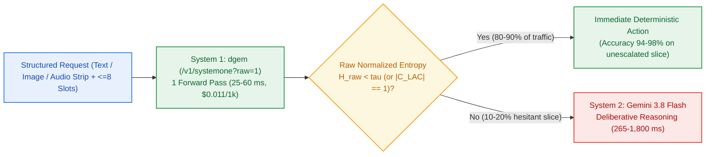
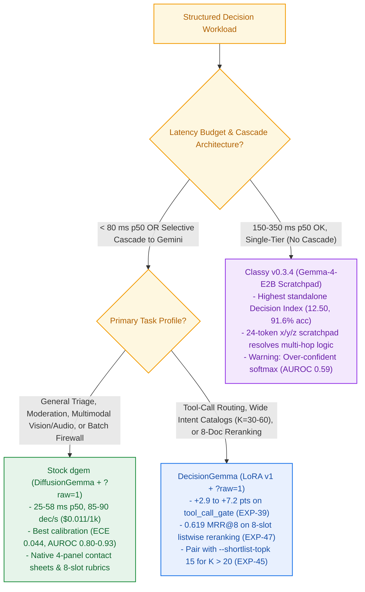

# Decision Models (`dgem`) Practitioner Guide

**Status**: Production Reference (`dgem v0.3.13`, `EXP-01`–`EXP-51`)  
**Repositories**: [`GoogleCloudPlatform/dgem`](https://github.com/ghchinoy/dgem) (SDK & CLI) | [`ghchinoy/decision-lab`](https://github.com/ghchinoy/decision-lab) (Benchmarks & Customer Examples)

## 1. System-1 Readout Versus System-2 Generation

Standard autoregressive language models operate as deliberative `System 2` generators: they emit tokens sequentially across dozens of forward passes (`300 ms` to `8,000 ms`), consume KV-cache memory bandwidth proportional to output length, and produce poorly calibrated greedy probabilities when constrained to single-token classifications.

`dgem` converts `DiffusionGemma` into a single-pass `System 1` decision engine via discrete block-diffusion slot readout:

1. **Single-Pass Multi-Slot Resolution (`25`–`62 ms` p50)**: A fixed 16-token diffusion block is seeded with up to 8 categorical slots (`questions`). In one bidirectional denoising step, the model resolves all 8 slots simultaneously.
2. **Calibrated Token-Level Shannon Entropy ($\tilde{H}_{\text{raw}} \in [0, 1]$)**: Each slot extracts the top-5 option-token log-probabilities (`A`, `B`, `C`, ...) and computes normalized Shannon entropy (`ECE = 0.044`, `Brier = 0.097`, error-detection `AUROC = 0.80`–`0.93`).
3. **Selective System-1 to System-2 Cascades**: High-confidence reads ($\tilde{H}_{\text{raw}} < \tau$) execute immediately at `$0.011` per `1,000` decisions (`85`–`90` decisions/s on a single RTX PRO 6000), while only ambiguous or high-risk inputs ($\tilde{H}_{\text{raw}} \ge \tau$) escalate to `Gemini 3.8 Flash`.

## 2. Runtime Selection Decision Matrix

Across `EXP-23`, `EXP-35`, `EXP-39`, and `EXP-51`, we benchmarked five model families on the `/v1/systemone` contract (`N >= 479` pooled items across `jev_systemone`, `calib_systemone`, `gate_mixed_noul`, `tool_call_gate`, and `BFCL`). Use the decision tree and table below to select the right runtime for your workload.

| Runtime Engine | p50 Latency (`1`–`8` Slots) | Pooled Accuracy / DI (`EXP-39`, `EXP-51`) | Error-Detection `AUROC` / `ECE` | Throughput & Unit Cost (`1k` dec) | Optimal Deployment Role |
| :--- | :---: | :---: | :---: | :---: | :--- |
| **Stock `dgem` (`DiffusionGemma` + `?raw=1`)** | **`25`–`58 ms`** | `77.1%` (`DI 10.42`) | **`0.80`–`0.93` AUROC / `0.044` ECE** | **`85`–`90 dec/s` (`\$0.011`)** | High-volume token firewall (`HSBC`), `<100ms` voice (`Parloa`), multimodal (`Bolttech`), Stage-1 cascade gate |
| **`DecisionGemma` (`r=16 LoRA` + `?raw=1`)** | **`28`–`62 ms`** | `81.2%` (`+7.2 pts` tool gates) | `0.78`–`0.91` AUROC / `0.058` ECE | **`80`–`85 dec/s` (`\$0.012`)** | Agent tool routing, 8-doc listwise reranking (`EXP-47`), `K=30`–`60` intent classification (`Citi`) |
| **`Classy v0.3.4` (`Gemma-4-E2B` Scratchpad)** | `177`–`340 ms` | **`91.6%` (`DI 12.50`)** | `0.59` AUROC / `0.142` ECE *(over-confident)* | `15`–`25 dec/s` (`~\$0.045`) | Standalone single-model classifier where `~250ms` is acceptable and no Stage-2 cascade is needed |
| **Embedding Classifiers (`Clef` / `Jev` Dual-Encoder)** | `8`–`15 ms` | `68.0%`–`74.5%` *(zero cross-attention)* | `0.62`–`0.68` AUROC | `300+ dec/s` (`\$0.003`) | Stage-0 top-15 candidate generator feeding `dgem` `--shortlist-topk 15` (`EXP-45`) |
| **`Gemini 3.8 Flash` (`thinking=off` / `low`)** | `265`–`1,800 ms` | `88.5%`–`93.4%` | N/A *(Stage-2 oracle)* | API token billing (`\$0.15`–`\$0.60`) | Stage-2 escalation reasoner for the `10%`–`20%` of inputs where `dgem` hesitates ($\tilde{H}_{\text{raw}} \ge \tau$) |

## 3. Five Canonical Production Architectures

### 3.1 Pattern A: Single-Pass Multi-Slot Rubric (`<= 8` Slots)

Instead of issuing separate classification calls for intent, urgency, PII exposure, and routing action, pack up to 8 independent or complementary questions into a single `dgem` policy. Because `DiffusionGemma` denoises all 8 answer positions in one forward pass, going from 1 slot (`25 ms`) to 8 slots (`58 ms`) adds zero additional forward passes.

- **Critical Requirement (`EXP-39`)**: Always target a serving image with native `/v1/systemone?raw=1` support (`v0.3.12+`, checked via [`FitsServingImage`](https://github.com/ghchinoy/dgem/blob/main/cmd/systemone_serve.go)). Bypassing chat-completion adapter re-wrapping improves pooled accuracy by **`+2.9 pts` (`+7.2 pts` on tool-call gates)**.

### 3.2 Pattern B: Selective Hesitation and Split Conformal Cascade

For workloads with strict precision floors (such as financial compliance or medical/legal routing), use `dgem`'s raw normalized Shannon entropy ($\tilde{H}_{\text{raw}}$) or a calibrated Split Conformal prediction set (`LAC` / `RAPS`) to decide whether to trust the System-1 readout or escalate to `Gemini 3.8 Flash`:

$$\tilde{H}_{\text{raw}}(x) = -\frac{1}{\ln K} \sum_{k=1}^{K} P_{\text{dgem}}(y_k \mid x) \ln P_{\text{dgem}}(y_k \mid x)$$

- **Fixed-Cardinality Gate ($K$ constant)**: Escalate when `slot.RawNormalizedEntropy >= 0.25` (captures `82%`–`93%` of errors while escalating only `15%`–`22%` of traffic in `EXP-34` and `EXP-44`).
- **Variable-Cardinality Gate ($K \in [2, 50]$, `EXP-49` Track B)**: Normalized entropy is not scale-invariant across different option counts $K$. Calibrate a Least Ambiguous Set-Valued Classifier (`LAC`) quantile $\hat{q}_{1-\alpha}$ on `100` labeled examples per slot:

$$C_{1-\alpha}(x) = \{y_k : 1 - P_{\text{dgem}}(y_k \mid x) \le \hat{q}_{1-\alpha}\}$$

Escalate to `Gemini 3.8 Flash` if and only if $|C_{1-\alpha}(x)| > 1$. In `EXP-49` (`N=800` live slots across $K \in \{2, 4, 10, 50\}$), `LAC` held empirical coverage between **`89.3%` and `92.2%` (`0.029` cross-$K$ spread)** versus a `0.420` spread for fixed entropy.

### 3.3 Pattern C: Wide-Option Shortlist and Cosine Fusion

When a slot has $K > 20$ options (e.g., `60`–`150` document types or banking intents), `dgem`'s default `BracketElimination` runs a 2-round tournament (`2.0` passes). If the caller already computes dense embeddings (such as `gemini-embedding-2-preview`), collapse the decision to **1 pass (`-45%` latency)** using [`ShortlistPrepass`](https://github.com/ghchinoy/dgem/blob/main/pkg/decisionindex/shortlist.go) and [`ApplyPriorLogits`](https://github.com/ghchinoy/dgem/blob/main/pkg/decisionindex/prior_evidence.go):

1. **Shortlist Top-15 (`--shortlist-topk 15`)**: Pass caller cosine similarities as `PriorLogits` so `PriorLogitsShortlist` prunes $K \to 15$ before prompt assembly (`98.0%`–`99.0%` top-15 recall on Banking77 and CLINC150 in `EXP-45`). Keep `ShortlistContrastive: false` (the default).
2. **Z-Score Cosine Normalization (`NormalizeCosinePriorLogits`)**: Raw embedding cosines cluster tightly in $[0.55, 0.78]$ ($\sigma \approx 0.04$). Scale them to unit variance divided by temperature $\tau = 0.07$:

$$\ell_{\text{prior}}(y_k) = \frac{\text{cos}(q, c_k) - \mu_{\text{cos}}}{\max(\sigma_{\text{cos}}, 10^{-6}) \cdot \tau}$$

3. **Hesitation-Gated Fusion (`--prior-gate-mode hesitant`)**: Fuse the normalized prior only when `dgem` is uncertain ($\tilde{H}_{\text{raw}} > 0.05$), and always drive downstream cascades from `RawNormalizedEntropy`:

$$\log \tilde{P}(y_k \mid x) \propto \log P_{\text{dgem}}(y_k \mid x) + \alpha \cdot \mathbb{I}[\tilde{H}_{\text{raw}} > 0.05] \cdot \ell_{\text{prior}}(y_k)$$

### 3.4 Pattern D: Two-RPC Sketch-Then-Decide (`TwoRpcCompiler`)

When a rubric requires extracting free-text entities (dates, policy numbers, arithmetic totals) before scoring categorical rules, a single diffusion pass loses accuracy on multi-hop dependencies (`60%` in `EXP-28`). [`TwoRpcCompiler`](https://github.com/ghchinoy/dgem/blob/main/pkg/decisionindex/tworpc.go) splits execution into two fast RPCs:
- **RPC 1 (`~210 ms`)**: A short generative sketch extracts the structured facts (`80`–`120` tokens).
- **RPC 2 (`~26 ms`)**: `dgem` reads the compact sketch and resolves all 5–8 categorical rubric slots in one pass, lifting accuracy from **`60%` to `79%` at `240 ms` total** (`18x` faster than `Gemini 2.5 Flash` thinking at `4,380 ms`).

### 3.5 Pattern E: High-Throughput Batch Pre-Filtering

For offline or nearline backlogs (`1M` to `100M+` records/day), deploy `dgem` on Cloud Run Jobs with RTX PRO 6000 GPUs (`EXP-31`):
- Set `MAX_INFLIGHT=64` and reserve `12 GiB` KV cache per replica.
- Each GPU sustains **`85`–`90` decisions/s**, processing `1,000,000` records in `108 minutes` across 2 GPUs at a total compute cost of **`\$11.00` (`\$0.011` per `1,000` decisions)**.

## 4. Enterprise Customer Reference Blueprints

Complete runnable implementations and policy schemas for all five customer archetypes reside in `ghchinoy/decision-lab/examples/customer-use-cases/`:

| Customer Archetype | Directory in `decision-lab` | Slot Design & Key Mechanism | Verified Live Receipt & Economics |
| :--- | :--- | :--- | :--- |
| **1. HSBC (`100B+` Tokens/Day Pre-Filter)** | `examples/customer-use-cases/01_hsbc_token_firewall/` | 4 slots (`material_event`, `compliance_exposure`, `sensitive_data_tier`, `firewall_action`) + `MCKP` trajectory pruning (`SelectContextPruningActions`). | Drops `~80%` routine chatter (`archive_drop`, $\tilde{H}_{\text{raw}} = 0.012$) at `\$0.011/1k`; escalates conduct/MNPI hits; `MCKP` cuts Gemini tokens by **`57.7%` at `100%` recall** (`EXP-49`). |
| **2. Citi (`K=30`–`150` Institutional Docs)** | `examples/customer-use-cases/02_citi_doc_classifier/` | 2 slots (`doc_type` $K=30 \to 15$, `extraction_queue`) + `ShortlistPrepass` + `NormalizeCosinePriorLogits` ($\tau=0.07$, `hesitant`). | Resolves `csa_credit_support_annex` + `derivatives_margin_ops` in **1 pass (`-45%` latency)**; `+4.0 pts` over raw cosines (`EXP-45`) and `-15%` to `-47%` Brier under prevalence shift (`EXP-48`). |
| **3. Lloyds (Governance & RAG Quarantine)** | `examples/customer-use-cases/03_lloyds_rag_governance/` | 8 co-denoised slots (`p1_rel`, `p1_sec`, ..., `p4_rel`, `p4_sec`) over `<untrusted_data>` blocks with 4-tier `use`-vs-`mention` security taxonomy. | Ranks authoritative policy `P1` #1 (`score 2.98`), preserves educational security doc `P2` (`benign_security_discussion`), and quarantines override attack `P4` (`score 0.00`, `ASR@1 = 0.0%`). |
| **4. Bolttech (Insurtech FNOL Claims)** | `examples/customer-use-cases/04_bolttech_fnol_claims/` | 5 slots (`peril_category`, `damage_severity`, `deterministic_tool_call`, `fraud_risk_tier`, `payout_routing`) fed by `TwoRpcCompiler` + 4-panel contact sheet. | Resolves `device_accidental_damage`, `repairable_component`, `dispatch_depot_repair_label`, and `straight_through_approve` in **1 pass** after sketch extraction (`240 ms` total). |
| **5. Parloa (`<300ms` Voice Compliance)** | `examples/customer-use-cases/05_parloa_voice_compliance/` | 5 slots (`caller_auth_state`, `mandatory_disclosure`, `guardrail_violation`, `prosodic_turn_state`, `live_orchestrator_action`). | Detects `partial_kba_passed` + `pre_auth_pii_leak` + `end_of_turn_respond` in **`58 ms` p50**, triggering `inject_compliance_whisper` with `>220 ms` SLA margin. |

## 5. Policy Authoring and Calibration Checklist

1. **Keep Per-Pass Option Counts $K \le 20$ (`az` Single-Token Budget)**:
   - Standard single-letter labels (`A`–`T`) have uniform tokenizer priors and high error-detection `AUROC` (`0.84+`).
   - Wide 52-code label sets (`az_aa` in `PROP-29`) avoid tournament brackets up to $K=52$ but reduce out-of-scope entropy `AUROC` (`0.84` $\rightarrow$ `0.65`). Prefer caller embedding shortlisting (`--shortlist-topk 15`) whenever embeddings exist.
2. **Write Mutually Exclusive, Positive Option Descriptions**:
   - Define each option by what it *is*, not by referencing other option names.
   - Include an explicit catch-all or abstain option (`none_of_the_above` or `insufficient_evidence`) when inputs can fall outside the domain taxonomy.
3. **Audit Order Bias on New Policies (`SwappedOrderAgreement`)**:
   - Run forward vs. reversed option order (`option_order=source` vs. `reversed`) on a 50-item dev slice. Policies with `SwappedOrderAgreement < 92%` have overlapping option descriptions that should be tightened before production rollout.
4. **Understand Concurrency Determinism (`PROP-32` & `PROP-34`)**:
   - Sequential `samples=1` requests are **100% deterministic (`0` flips across `2,731` questions in `PROP-32`)**.
   - Under concurrent load (`concurrency >= 8`), borderline slots ($\tilde{H}_{\text{raw}} > 0.25$) exhibit a `6%`–`9%` flip rate caused by vLLM dynamic batch-composition floating-point non-associativity (`PROP-34`). Any slot within that flip band already satisfies $\tilde{H}_{\text{raw}} \ge 0.25$ and should be routed to the Stage-2 cascade or evaluated with `samples=3`.

## 6. Empirically Falsified Anti-Patterns

Every anti-pattern below was tested on live `/v1/systemone` endpoints in `ghchinoy/decision-lab` and rejected based on negative empirical results:

| Anti-Pattern (Do Not Do This) | Measured Failure Mode (`decision-lab` Receipt) | Validated Production Alternative |
| :--- | :--- | :--- |
| **1. Appending `[vs siblings: ...]` contrastive suffixes to shortlisted options (`EXP-45`)** | Drops single-pass accuracy by **`-6.0 pts` on `K=30` (`82%` $\rightarrow$ `76%`)** and **`-7.0 pts` on `K=60` (`84%` $\rightarrow$ `77%`)** due to token cross-talk in the 16-token block. | Keep `ShortlistContrastive: false` (default in `dgem#198`). Let clean option descriptions stand alone. |
| **2. Using surface lexical overlap (`LexicalOverlapShortlist`) to shortlist paraphrased user intents (`EXP-41`)** | Top-15 shortlist recall collapses to **`65.2%`–`69.5%`** on Banking77/CLINC150, capping end-to-end accuracy `-11.5 pts` below 2-round brackets. | Supply dense embedding cosines (`gemini-embedding-2-preview`) via `PriorLogitsShortlist` (**`98%`–`99%` recall**), or fall back to 20-way `BracketElimination`. |
| **3. Replacing 20-way tournament brackets with a 1-pass or 2-pass Hierarchical Taxonomy Trie (`EXP-46`)** | 1-pass joint parent+leaf trie drops accuracy by **`-38.1 pts`** (`43.4%` vs. `81.5%`); 2-pass top-2 beam trie still trails brackets by **`-17.3 pts`** due to irreversible root routing errors. | Use 1-pass embedding shortlists (`--shortlist-topk 15`) when embeddings exist, or standard 20-way `BracketElimination` (`2.0` passes) for cold-start catalogs. |
| **4. Gating downstream cascades on post-fusion `NormalizedEntropy` instead of `RawNormalizedEntropy` (`EXP-40`, `EXP-44`)** | A sharp external prior masks model uncertainty when the prior and `dgem` disagree, reducing error-detection `AUROC` by **`-0.041` (`-4.1 pts`)**. | Always read `slot.RawNormalizedEntropy` ($\tilde{H}_{\text{raw}}$) for cascade escalation decisions. |
| **5. Running a 2-pass self-prior cascade for cold-start 8-document reranking (`EXP-47`)** | Pass-1 coarse intent classification followed by Pass-2 reranking doubles latency (`2.0` passes) and **reduces `MRR@8` by `-0.025`** compared to a single-pass 8-slot co-read. | Score all 8 candidate documents jointly in **1 pass** (`0.619 MRR@8`, `0.680 nDCG@8` on `DecisionGemma`). |
| **6. Using binary keyword triggers for RAG prompt-injection quarantine (`EXP-50`)** | Causes a **`36.4%`–`56.4%` false-quarantine rate** on benign security or audit documentation that quotes attack phrases as educational examples. | Use the 4-tier `use`-vs-`mention` security taxonomy (`clean`, `benign_security_discussion`, `suspicious_framing`, `active_override_attempt` in `PROP-48`). |
