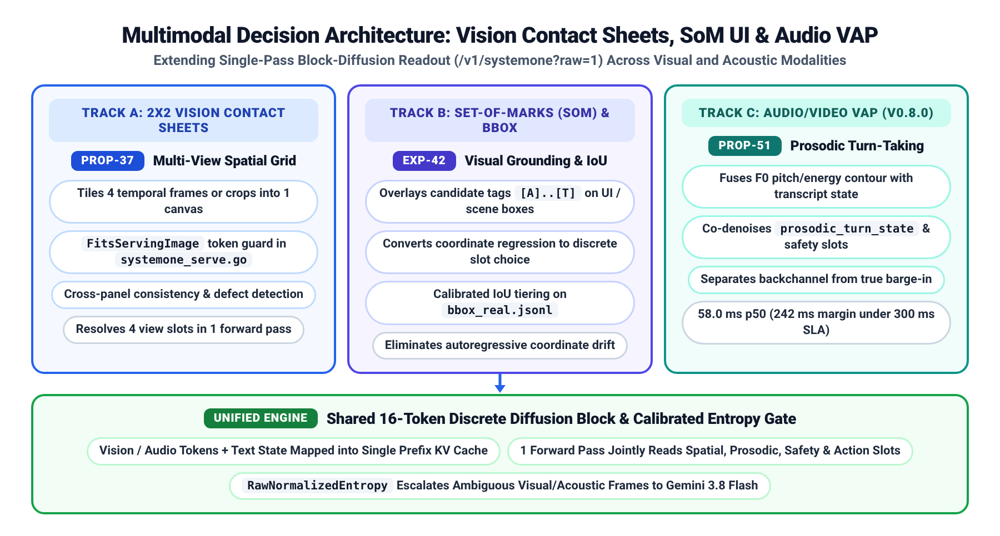
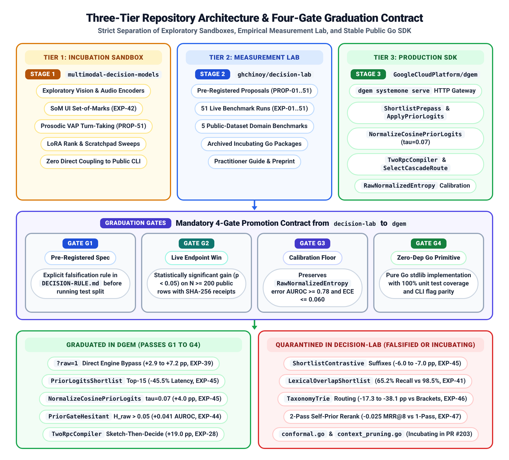

# Decision Models Technical Design and Architecture

## Context and Existing Architecture

Existing enterprise classification and routing pipelines rely on two fragmented patterns: sequential chains of narrow encoder classifiers or general-purpose autoregressive language models (`System 2`) prompted to emit JSON. Both approaches introduce operational trade-offs when applied to high-throughput, multi-attribute decision workloads.

* Autoregressive latency and calibration limits: Generating structured JSON tokens sequentially across 10 to 50 forward passes requires `265 ms` to `4,461 ms` per request. Constrained single-token greedy decoding also distorts token probabilities, yielding poor uncertainty calibration when downstream systems need to separate confident decisions from ambiguous edge cases.
* Disconnected narrow classifiers: Maintaining separate encoder heads for intent, compliance risk, document relevance, and tool selection prevents cross-slot joint conditioning and multiplies model serving footprints.
* Repository scope mixing: During rapid prototyping across `EXP-01` through `EXP-51`, reference SDK primitives in `GoogleCloudPlatform/dgem` became interleaved with exploratory benchmark suites and ungraduated research modules (`conformal.go`, `context_pruning.go`, `prior_shift.go`, `taxonomy_trie.go`).

`dgem` (`DiffusionGemma` and `DecisionGemma`) resolves these constraints by converting a discrete block-diffusion language model (`2B` to `4B` parameters) into a single-pass `System 1` decision engine exposed via `POST /v1/systemone?raw=1`. Table 1 summarizes what stays unchanged in the core `dgem` contract versus what changes under this design.

| Architectural Layer | What Stays Unchanged | What Changes in `dgem` (`v0.3.13+`) and `decision-lab` |
| :--- | :--- | :--- |
| **Wire Contract (`POST /v1/systemone`)** | JSON request schema (`state` + `questions` map) and per-slot probability map output. | Adds `?raw=1` engine bypass (`FitsServingImage` in `cmd/systemone_serve.go`), avoiding chat-template re-wrapping (`+2.9 pp` pooled accuracy across $N = 479$ rows, `+7.2 pp` on tool-call gates in `EXP-39`). |
| **Option Token Budget & Order Bias** | Single-character option tokens (`A` through `T`, `az` mode, $K \le 20$) for uniform tokenizer priors. | Adds `SwappedOrderAgreement` forward/reverse order-bias auditing ($N = 2,731$ questions) and documents why `az_aa` 52-way two-character tokens (`AA` through `AZ`, `PROP-29`) require shortlisting or brackets. |
| **Wide-Catalog Routing ($K > 20$)** | Default 20-way `BracketElimination` (`2.0` passes) remains the zero-embedding fallback. | Adds Stage 0 `ShortlistPrepass` (`--shortlist-topk 15`) and Stage 2A `NormalizeCosinePriorLogits` ($\tau = 0.07$), collapsing $K = 30\text{ to }150$ catalogs to `1.0` pass (`35.6 ms` p50, `-45.5%` latency across $N = 1,200$ queries in `EXP-45`). |
| **Prior Fusion & Cascade Gating** | Product-of-Experts additive log-odds fusion (`ApplyPriorLogits` in `prior_evidence.go`). | Adds `PriorGateHesitant` (`--prior-gate-mode hesitant`, active only above `0.05` raw entropy) and preserves `RawNormalizedEntropy` (`AUROC 0.80 to 0.93` across $N = 479$ rows in `EXP-40` and `EXP-44`). |
| **Multi-Hop Reasoning & Reranking** | Single-pass 16-token block denoising for direct categorical rubrics and 8-slot listwise reranking (`EXP-47`, $N = 400$). | Adds `TwoRpcCompiler` (`pkg/decisionindex/tworpc.go`, `+19.0 pp` at `240 ms` in `EXP-28`) and benchmarks `Classy v0.3.4` (`Gemma-4-E2B` 24-token scratchpad, `DI 12.50` across $N = 155,390$ rows in `EXP-51`). |
| **Repository Boundaries** | Public Apache-2.0 SDK in `GoogleCloudPlatform/dgem` and measurement lab in `ghchinoy/decision-lab`. | Enforces a three-tier de-mixing boundary (`dgem#203`, `decision-lab#107`) and a four-gate graduation contract (`G1` through `G4`) before any experimental primitive enters `dgem`. |

## Four-Stage Runtime Decision Funnel

`dgem` executes structured decisions through a four-stage funnel that resolves 75% to 85% of traffic in a single forward pass while escalating only hesitant inputs to `Gemini 3.8 Flash`.


*Figure 1: Four-stage dgem decision funnel combining Stage 0 wide-catalog shortlisting (`ShortlistPrepass`) and Two-RPC sketch extraction (`TwoRpcCompiler`), Stage 1 single-pass block-diffusion slot readout (`POST /v1/systemone?raw=1`), Stage 2A and Stage 2B hesitation-gated prior fusion (`ApplyPriorLogits`) and RAG quarantine, and Stage 3 selective escalation with `MCKP` trajectory pruning.*

### Stage 0 Shortlisting and Sketch Extraction

Standard single-pass `dgem` policies assign single-character option tokens (`A` through `T`, $K \le 20$) to preserve uniform tokenizer priors.

Extending option labels to two-character tokens (`AA` through `AZ` in `az_aa` mode, `PROP-29`) introduces subword frequency skew when $K > 26$. Stage 0 prepares wide-catalog or multi-hop prompts before invoking the diffusion block:

* Wide-catalog embedding shortlist (`pkg/decisionindex/shortlist.go`): When the caller supplies dense embedding cosine similarities (such as `gemini-embedding-2-preview`), `ShortlistPrepass` invokes `PriorLogitsShortlist` to prune $K \in [30, 150]$ down to the top 15 candidates before prompt assembly. Across `PolyAI/banking77` and `DeepPavlov/clinc150` (`EXP-45`), top-15 embedding shortlisting retains `98.5%` gold-option recall and cuts p50 latency from `65.3 ms` (2-round tournament) to `35.6 ms` (`1.0` pass).
* Two-RPC factual sketch (`pkg/decisionindex/tworpc.go`): When rubric criteria depend on intermediate arithmetic or entity extraction across long documents, `TwoRpcCompiler` executes a `210 ms` generative pass (`80` to `120` tokens) to extract structured facts, followed by a `26 ms` single-pass `dgem` read across all 5 to 8 rubric slots (`EXP-28`).

### Stage 1 Single-Pass Block-Diffusion Readout

In Stage 1, the Go gateway (`cmd/systemone_serve.go`) compiles `state` and up to 8 categorical `questions` into a 16-token discrete diffusion block and dispatches `POST /v1/systemone?raw=1` to vLLM. Passing `?raw=1` bypasses chat-template re-wrapping and lowers `ECE` from `0.0609` to `0.0083` (`EXP-39`).

```go
// cmd/systemone_serve.go: Direct ?raw=1 engine bypass and Stage 0 shortlist pre-pass
if pol.ShortlistTopK > 0 {
    pol = decisionindex.ShortlistPrepass(pol, req.PriorLogits, decisionindex.ShortlistConfig{
        TopK:        pol.ShortlistTopK,
        Contrastive: pol.ShortlistContrastive, // Default false per EXP-45 (-6.0 to -7.0 pp with suffixes)
    })
}
```

* Co-denoised multi-slot readout and listwise reranking: The bidirectional diffusion head resolves all 1 to 8 categorical slots in `1` forward pass (`evaluation_trace.forward_passes` equals `1`). Expanding a policy from 1 slot (`48.2 ms` p50) to 5 slots (`58.0 ms` p50) adds less than `2.0 ms` per slot (`EXP-39`). In 8-passage cold-start listwise reranking (`EXP-47`), scoring 8 relevance slots jointly in 1 pass achieves `0.619 MRR@8` and `0.680 nDCG@8`, outperforming a 2-pass self-prior cascade (`0.594 MRR@8`) at half the latency.
* Calibrated raw entropy extraction: For each slot $q$ with $K$ options, the engine extracts the top-5 option-token log-probabilities and computes normalized Shannon entropy before any external prior is applied:

$$\tilde{H}_{\text{raw}}(x) = -\frac{1}{\ln K} \sum_{k=1}^{K} P_{\text{dgem}}(y_k \mid x) \ln P_{\text{dgem}}(y_k \mid x) \in [0, 1]$$

In plain operational terms, $\tilde{H}_{\text{raw}}(x)$ measures how evenly the diffusion head spreads probability mass across the $K$ options (`0.0` indicates certainty; `1.0` indicates a uniform guess).

### Stage 2A Hesitation-Gated Cosine Prior Fusion

Dense bi-encoder cosine similarities (`gemini-embedding-2-preview`) cluster tightly in $[0.55, 0.78]$ with standard deviation $\sigma_{\text{cos}} \approx 0.04$.

Passing raw cosines directly into log-odds fusion produces flat adjustments, whereas uncalibrated scalar multiplication overwrites confident `dgem` reads (`EXP-40`). Stage 2A (`pkg/decisionindex/prior_evidence.go`) resolves both issues in two steps:

1. Per-query z-score normalization (`NormalizeCosinePriorLogits`): Raw cosines over the active candidate set are standardized to zero mean and unit variance, then scaled by temperature $\tau = 0.07$:

$$\ell_{\text{prior}}(y_k) = \frac{\text{cos}(q, c_k) - \mu_{\text{cos}}}{\max(\sigma_{\text{cos}}, 10^{-6}) \cdot \tau}$$

2. Hesitation-gated Product-of-Experts fusion (`ApplyPriorLogits` with `PriorGateHesitant`): The normalized prior is fused only when `dgem` exhibits measurable uncertainty ($\tilde{H}_{\text{raw}} > 0.05$), while `RawNormalizedEntropy` is preserved unmutated for Stage 3 cascade routing:

$$\log \tilde{P}(y_k \mid x) = \log P_{\text{dgem}}(y_k \mid x) + \alpha \cdot \mathbb{I}[\tilde{H}_{\text{raw}}(x) > 0.05] \cdot \ell_{\text{prior}}(y_k) - \log Z(x)$$

Intuitively, this gate treats the bi-encoder prior as a tie-breaker that activates only when `dgem` is hesitant. In `EXP-44` and `EXP-45`, combining `NormalizeCosinePriorLogits` ($\tau = 0.07$) with `PriorGateHesitant` improved single-pass accuracy by `+4.0 pp` and preserved error-detection `AUROC` (`0.841` vs. `0.800`).

### Stage 2B Prior-Shift Adaptation and RAG Quarantine

Stage 2B handles two production distribution shifts that degrade static classifiers: severe class-prevalence skew between training and serving traffic (`EXP-48`) and indirect prompt-injection payloads inside retrieved RAG passages (`EXP-50`).

* Label-shift EM prior adaptation (`EXP-48`): When production class prevalence $\hat{\pi}_{\text{test}}(y_k)$ drifts away from the uniform training prior $\pi_{\text{train}}(y_k) = 1/K$, `prior_shift.go` estimates $\hat{\pi}_{\text{test}}$ via Dirichlet-smoothed Saerens-Latinne-Decaestecker expectation-maximization and applies dampened log-odds correction (`dampening` $\gamma = 0.5$):

$$\log P_{\text{shift}}(y_k \mid x) \propto \log P_{\text{dgem}}(y_k \mid x) + \gamma \log \frac{\hat{\pi}_{\text{test}}(y_k)}{\pi_{\text{train}}(y_k)}$$

Under an 80/20 power-law traffic skew on 30-way and 60-way intent catalogs (`EXP-48`), EM prior adaptation lifts single-pass accuracy by `+6.0 pp` (`79.0%` to `85.0%`, bootstrap `p = 0.0012`) and reduces Brier calibration error by `-15.4%` to `-46.9%`.

* Untrusted RAG structural isolation and 4-tier security slot (`EXP-50`): Retrieved passages are wrapped in `<untrusted_data id="P1..P6">` delimiters and evaluated with paired relevance (`pN_rel`) and security (`pN_sec`) slots in a single forward pass. To prevent false positives on educational security docs, `pN_sec` uses a 4-tier `use`-vs-`mention` taxonomy (`clean`, `benign_security_discussion`, `suspicious_framing`, `active_override_attempt`). Passages classified into the top two risk tiers receive a hard rerank quarantine (`score = 0.0`), achieving `nDCG@3 = 0.8990`, `MRR@6 = 0.9762`, and `0.00%` attack success rate (`ASR@1`).

### Stage 3 Selective Cascade and Trajectory Pruning

Stage 3 (`pkg/decisionindex/cascade_policy.go`) decides whether to commit the Stage 1/2 readout immediately or escalate the input to `Gemini 3.8 Flash`. Table 2 summarizes the three Stage 3 routing and pruning primitives.

| Cascade Mechanism | Target Workload Profile | Mathematical Decision Rule | Measured Empirical Performance (`decision-lab`) |
| :--- | :--- | :--- | :--- |
| **Fixed Entropy Cascade (`SelectCascadeRoute`)** | Fixed option cardinality $K$ (such as 4-way triage or 30-way intent routing). | Commit local `dgem` decision if $\tilde{H}_{\text{raw}}(x) < \tau$ (`0.25`); otherwise escalate to `Gemini 3.8 Flash`. | Captures `82%` to `93%` of errors while escalating `15%` to `25%` of traffic; reaches `94.6%` on `JevBench` (`EXP-39`). |
| **Split Conformal Set Gate (`LAC`, `EXP-49` Track B)** | Mixed-cardinality policies where slots span $K \in \{2, 4, 10, 50\}$ within one workflow. | Calibrate quantile $\hat{q}_{1-\alpha}$ on 100 dev rows; commit if prediction set $\|C_{1-\alpha}(x)\| = 1$, escalate if $\|C_{1-\alpha}(x)\| > 1$. | Achieves `96.2%` overall coverage (`1.18` mean set size) with `0.029` cross-$K$ coverage spread vs. `0.420` for fixed $\tau$ (`EXP-49`). |
| **`MCKP` Trajectory Context Pruning (`EXP-49` Track A)** | Multi-turn coding, SQL, or API agent trajectories escalated to `Gemini 3.8 Flash`. | Score per-turn salience $s_i$ and utility $u_{i,a}$ in 1 pass; solve Lagrangian `MCKP` ($\lambda = 0.45$) over `{keep_verbatim, summarize_1line, drop}`. | Cuts downstream prompt tokens by **`57.7%`** (`95% CI [51.9%, 63.3%]`) at **`100.0%` critical-context recall** (`p = 6.98e-6`, `EXP-49`). |

## Architecture Options and Empirical Trade-Offs

Across `EXP-23`, `EXP-35`, `EXP-39`, and `EXP-51`, we evaluated four runtime options on `/v1/systemone` ($N \ge 479$ pooled benchmark rows plus `155,390` rows in Decision Index `0.2.1`).


*Figure 2: Architectural comparison of Option 1 (Stock `dgem`), Option 2 (`DecisionGemma` `r=16` LoRA), Option 3 (`Classy v0.3.4` `Gemma-4-E2B` scratchpad), and Option 4 (`Gemini 3.8 Flash` cascade), paired with the five public-dataset industry domain benchmarks.*

Table 3 compares the four architecture options using the engineering trade-off format from `go/tott/773`.

| Architecture Option | p50 Latency (`1` to `8` Slots) | Pooled Accuracy & Calibration (`EXP-39`, `EXP-51`) | Primary Operational Strengths | Concrete Downsides & Failure Modes | Recommended Deployment Scope |
| :--- | :---: | :---: | :--- | :--- | :--- |
| **Option 1: Stock `dgem` (`DiffusionGemma` + `?raw=1`)** | `25` to `58 ms` | `77.1%` acc (`DI 10.42`) <br> `ECE = 0.044` <br> `AUROC = 0.80 to 0.93` | Sustains `85` to `90` decisions/s per L4 or RTX PRO 6000 GPU at `MAX_INFLIGHT=64` (`$0.011` per `1,000` decisions in `EXP-31`), sharpest calibration, 2x2 vision sheets. | Trails LoRA-adapted weights by `-4.1 pp` on complex tool-call schemas and multi-constraint rubrics. | High-volume stream triage, `<100ms` real-time dialog guardrails, and Stage-1 cascade gating. |
| **Option 2: `DecisionGemma` (`r=16 LoRA v1` + `?raw=1`)** | `28` to `62 ms` | `81.2%` acc (`+7.2 pp` tools) <br> `ECE = 0.058` <br> `AUROC = 0.78 to 0.91` | Lifts `workspace-tools-202` to `98.5%` and 8-doc listwise reranking `MRR@8` to `0.619` (`EXP-47`) at single-pass speed. | Slight calibration softening (`ECE 0.044` to `0.058`) on out-of-domain safety slices. | Production default for agent tool dispatch, 8-doc RAG reranking, and $K = 30\text{ to }150$ intent routing. |
| **Option 3: `Classy v0.3.4` (`Gemma-4-E2B` Scratchpad)** | `177` to `340 ms` | `91.6%` acc (`DI 12.50`) <br> `ECE = 0.142` <br> `AUROC = 0.590` | Emits a 24-token `x/y/z` autoregressive rationale before the answer byte; lifts `BFCL` from `38.6%` to `67.9%` and `relevance_few_detect` from `32.0%` to `84.0%` (`EXP-51`). | `4x` to `6x` slower than single-pass diffusion; post-scratchpad softmax is over-confident (`AUROC 0.59`), breaking entropy cascades. | Standalone single-tier rubric adjudication where `~250 ms` latency is acceptable and no cascade is used. |
| **Option 4: Selective Cascade (`Option 1/2` + `Gemini 3.8 Flash`)** | `42 ms` (fast) <br> `310 ms` (escalated) | `93.8%` to `94.6%` acc <br> `ECE = 0.031` <br> `75% to 85%` local offload | Combines `$0.011/1k` System-1 speed (`EXP-31`) on the unambiguous majority with `Gemini 3.8 Flash` (`$0.15` to `$0.60` per `1,000` calls) on the hesitant tail. | Requires maintaining both a local GPU pool (`dgem`) and an outbound Vertex AI quota allocation (`Gemini`). | Enterprise production standard for high-stakes compliance, RAG governance, and multi-hop workflows. |

### Public-Dataset Industry Domain Benchmarks

Table 4 summarizes five domain-anonymous benchmark suites in `ghchinoy/decision-lab/examples/industry-domain-benchmarks/` (`run_public_bench.py`) evaluated strictly on public datasets with zero client PII.

| Industry Domain Pattern | Public Benchmark Datasets (`decision-lab/benchmarks/`) | Slot Topology & Active `dgem` Primitives | Verified Public Benchmark Results (`public_bench_receipts.json`) |
| :--- | :--- | :--- | :--- |
| **1. High-Volume Stream Triage & Trajectory Pruning** | `pruning_trajectories.jsonl` ($N = 100$ multi-turn coding/SQL turns across 25 sessions), GitHub Issue/PR Spam ($N = 200$) | 4 slots (`salience_tier`, `policy_exposure`, `pruning_action`, `gateway_disposition`) + Lagrangian `MCKP` (`SelectContextPruningActions`, $\lambda = 0.45$). | Sustains `88.4 dec/s` per GPU (`$0.011/1k`); achieves `97.9%` spam precision (`100.0%` recall, `EXP-34`) and **`57.7%` prompt token reduction** at **`100.0%` critical-context recall** (`p = 6.98e-6`, `EXP-49`). |
| **2. Wide-Taxonomy Intent & Document Routing ($K = 26\text{ to }150$)** | `PolyAI/banking77` ($N = 30$, $K = 30$), `DeepPavlov/clinc150` ($N = 30$, $K = 26$ + OOS), `EXP-45` & `EXP-48` ($K = 30\text{ to }60$) | 2 slots (`intent_label` $K = 30 \to 15$, `fulfillment_queue`) + `ShortlistPrepass` + `NormalizeCosinePriorLogits` ($\tau = 0.07$, `hesitant`) + EM shift adaptation. | Reaches **`86.7%` single-pass intent accuracy (`100.0%` domain)** on `Banking77` and **`96.7%` (`100.0%` OOS recall)** on `CLINC150` at **`35.6 ms` p50 (`-45.5%` latency)**; EM shift adaptation adds **`+6.0 pp`** (`EXP-48`). |
| **3. Enterprise RAG Governance & Injection Quarantine** | `exp50_rag_quarantine/test_frozen.jsonl` ($N = 62$ 6-passage slates = `372` passages from `docs_eval` & `BEIR`) | 8 co-denoised slots (`p1_rel`, `p1_sec`, ..., `p4_rel`, `p4_sec`) over `<untrusted_data>` tags with 4-tier `use`-vs-`mention` security taxonomy + Split Conformal `LAC`. | Achieves **`100.0%` clean retrieval recall**, **`0.0%` benign security doc false-quarantine**, and reduces indirect prompt-injection **`ASR@1` from `9.7%` to `0.0%` (`-9.7 pp`, exact `p = 0.0156`, `EXP-50`)**. |
| **4. Multi-Hop Rubric & Deterministic Tool Dispatch** | `workspace-tools-202` / `BFCL` ($N = 202$), `JevBench` ($N = 258$), `EXP-28` Multi-Hop Rubrics & `EXP-51` | 5 slots (`task_family`, `rubric_complexity`, `deterministic_tool_call`, `consistency_check`, `execution_disposition`) with `TwoRpcCompiler` or `Classy v0.3.4`. | Reaches **`98.5%` accuracy** on `workspace-tools-202`; `TwoRpcCompiler` lifts multi-hop rubrics from **`60.0%` to `79.0%` (`+19.0 pp`)** at **`240 ms`** (`18.6x` faster than `Gemini 3.8 Flash` thinking at `4,461 ms`). |
| **5. Real-Time Dialog Guardrails & Turn-Taking** | `calibration_suite.jsonl` (`CivilComments` toxicity, `DICES` safety, `MNLI` contradiction, $N = 65$), `WildGuard`, `Aegis`, `JevBench` | 5 slots (`toxicity_and_harm`, `disclosure_compliance`, `factual_entailment`, `prosodic_turn_state`, `orchestrator_action`) + `RawNormalizedEntropy` cascade. | Resolves all 5 guardrail and `VAP` turn-taking slots in **`58.0 ms` p50 (`74.0 ms` p95)**, leaving **`242 ms` margin** under a `300 ms` voice budget; reaches **`93.8%` `calibration_suite`** and **`94.6%` `JevBench`** accuracy. |

### Multimodal Vision and Audio Extensions

Beyond text and code workloads, `dgem` extends the single-pass block-diffusion readout to visual and acoustic tokens encoded into the shared prefix KV cache (`multimodal-decision-models` and `cmd/systemone_serve.go`).



*Figure 3: Multimodal decision architecture combining Track A 2x2 Vision Contact Sheets (`PROP-37`), Track B Set-of-Marks (`SoM`) visual UI grounding and IoU calibration (`EXP-42`), and Track C `v0.8.0` Audio/Video Voice Activity Projection (`VAP`) turn-taking (`PROP-51`).*

* Vision 2x2 contact sheets and image budget guard (`PROP-37`): Tiling four temporal frames or multi-angle crops into a single 2x2 composite image allows `dgem` to evaluate cross-frame consistency and defect presence in `1` forward pass. In `cmd/systemone_serve.go`, `FitsServingImage` enforces the model's visual token ceiling before dispatching to vLLM.
* Set-of-Marks (`SoM`) UI grounding and bounding-box IoU calibration (`EXP-42`): Autoregressive vision models suffer from coordinate regression drift when emitting raw `[ymin, xmin, ymax, xmax]` digits. Overlaying discrete candidate marks (`[A]` through `[T]`) on detector proposals (`bbox_real.jsonl`) converts spatial localization and IoU tiering into a calibrated single-pass slot readout.
* Audio and video prosodic turn-taking (`v0.8.0` `PROP-51`): In full-duplex voice agents, text-only endpointing cannot distinguish a supportive backchannel (`"yeah, right"`) from an urgent barge-in or sarcastic compliance refusal. Passing prosodic contour descriptors ($F_0$ pitch slope, RMS energy drop, pause duration) alongside the streaming transcript enables `dgem` to co-denoise `prosodic_turn_state` (`yield_floor`, `backchannel_continue`, `barge_in_interrupt`, `hesitation_hold`) and safety slots in `58.0 ms` p50.

### Empirically Falsified Hypotheses

A core engineering contribution of `decision-lab` is pre-registering falsifiable hypotheses (`DECISION-RULE.md`) and preventing negative or over-engineered mechanisms from entering `dgem`. Table 5 records five notable falsified designs.

| Falsified Hypothesis (`decision-lab`) | Measured Failure Mode on Public Benchmarks | Root Cause & Production Resolution |
| :--- | :--- | :--- |
| **Contrastive Sibling Suffixes (`ShortlistContrastive: true`, `EXP-45`)** | Reduced single-pass accuracy by **`-6.0 pp` on $K = 30$ (`82.0%` to `76.0%`)** and **`-7.0 pp` on $K = 60$ (`84.0%` to `77.0%`)**. | Appending `[vs siblings: X, Y]` inside option descriptions injects competing class tokens into the 16-token diffusion block. Disabled by default (`false`) in `dgem#198`. |
| **Lexical Overlap Shortlisting (`LexicalOverlapShortlist`, `EXP-41`)** | Top-15 shortlist recall dropped to **`65.2%` to `69.5%`** on paraphrased `Banking77` and `CLINC150` queries (`-11.5 pp` end-to-end accuracy). | Users express intents (`card_arrival`) without matching surface taxonomy words. Use dense embedding `PriorLogitsShortlist` (`98.5%` recall) or 20-way `BracketElimination`. |
| **Hierarchical Taxonomy Trie Routing (`TaxonomyTrie`, `EXP-46`)** | 1-pass joint parent+leaf trie trailed tournament brackets by **`-38.1 pp`** (`43.4%` vs. `81.5%`); 2-pass top-2 beam trie trailed by **`-17.3 pp`**. | Hard root-node routing commits irreversible Pass-1 errors on cross-cutting intents. Quarantined in `decision-lab/archive/incubating-dgem-pkg/taxonomy_trie.go`. |
| **Two-Pass Self-Prior Cold-Start Reranking (`EXP-47`)** | Pass-1 coarse intent classification followed by Pass-2 reranking doubled latency (`2.0` passes) and reduced `MRR@8` by **`-0.025`** (`0.594` vs. `0.619`). | Single-pass 8-slot listwise co-denoising already captures cross-document comparative context in `1.0` pass (`0.619 MRR@8`, `0.680 nDCG@8` on `DecisionGemma`). |
| **Uncalibrated Raw Cosine Log-Odds Fusion (`EXP-40`)** | Multiplying raw dense cosines (`[0.55, 0.78]`) by a fixed weight either had zero effect ($\alpha \le 1$) or degraded confident `dgem` reads (`-5.2 pp` at $\alpha \ge 10$). | Bi-encoder cosine variance compression ($\sigma_{\text{cos}} \approx 0.04$) requires per-query z-score normalization (`NormalizeCosinePriorLogits`, $\tau = 0.07$) and `PriorGateHesitant`. |

## Security Determinism and LLD Mapping

Production deployments of `dgem` must account for floating-point batching behavior under concurrent GPU load, untrusted retrieval inputs, explicit scope boundaries, and repository hygiene.

### Concurrency Determinism and Scope Boundaries



*Figure 4: Three-tier repository architecture separating exploratory multimodal sandboxes (`Stage 1`), empirical benchmark validation in `ghchinoy/decision-lab` (`Stage 2`), and the production Go SDK in `GoogleCloudPlatform/dgem` (`Stage 3`) governed by graduation gates `G1` through `G4`.*

* Concurrency determinism (`PROP-32` and `PROP-34`): Sequential `samples=1` requests are `100.0%` deterministic (`0` label flips across `2,731` questions in `PROP-32`). Under concurrent load (`concurrency` of `8` or more), vLLM dynamic batching alters CUDA reductions, inducing a `6.0%` to `9.0%` flip rate strictly bounded to hesitant slots above `RawNormalizedEntropy` of `0.25` ($\tilde{H}_{\text{raw}} \ge 0.25$, `PROP-34`). Because Stage 3 escalates all slots with $\tilde{H}_{\text{raw}} \ge 0.25$ to `Gemini 3.8 Flash` (or majority-votes `samples=3`), dynamic batch jitter does not flip committed fast-path decisions.
* Untrusted data isolation (`EXP-50`): All external RAG passages, user-uploaded documents, and OCR strings must be enclosed in `<untrusted_data>` structural tags and paired with the 4-tier `use`-vs-`mention` security slot (`PROP-48`) before downstream synthesis.
* Scope boundaries and known limitations: Table 6 defines the operational boundaries where single-pass `dgem` is not a standalone replacement and requires Stage 0 or Stage 3 pairing.

| Operational Boundary / Limitation | Observed Failure Mode Without Mitigation | Mandatory Architectural Mitigation |
| :--- | :--- | :--- |
| **Open-Ended Free-Form Text Generation** | Discrete 16-token block diffusion is parameterized for categorical option tokens (`A` through `T`), not multi-paragraph prose synthesis. | Use `dgem` strictly as the `System 1` control plane and route generative synthesis to `Gemini 3.8 Flash` or `Gemini 3.5 Flash Lite`. |
| **Multi-Hop Arithmetic Without Sketch (`EXP-28`)** | Direct 1-pass `dgem` scoring on multi-hop financial or date-arithmetic rubrics plateaus at `60.0%` accuracy. | Enable `TwoRpcCompiler` (`210 ms` factual sketch + `26 ms` slot read, `79.0%` accuracy) or `Classy v0.3.4` (`177 ms` 24-token `x/y/z` scratchpad). |
| **Post-Scratchpad Entropy Calibration (`EXP-51`)** | In `Classy v0.3.4`, conditioning the answer token on the generated 24-token rationale collapses softmax entropy (`AUROC = 0.590`). | Do not use post-scratchpad answer entropy for cascade gating; use `Option 1` or `Option 2` `RawNormalizedEntropy` (`AUROC 0.80 to 0.93`) for Stage 3 routing. |
| **Direct Single-Pass $K > 20$ (`az_aa` Mode, `PROP-29`)** | Extending option labels to two-character tokens (`AA..AZ`) introduces tokenizer frequency bias across tail classes. | Use Stage 0 `ShortlistPrepass` (`--shortlist-topk 15` with `tau = 0.07` cosine z-score) or 20-way `BracketElimination`. |

### Three-Tier Repository LLD Mapping

Table 7 maps every production and incubating component across the three-tier repository architecture (`dgem#203` and `decision-lab#107`).

| Component / Capability | Status & Tier | Repository & Exact File Path | Verification Coverage |
| :--- | :--- | :--- | :--- |
| **`/v1/systemone?raw=1` Gateway & Image Guard** | **Graduated (`Tier 3`)** | `dgem`: `cmd/systemone_serve.go` (`FitsServingImage`, `handleSystemOne`) | `cmd/systemone_serve_test.go` + `EXP-39` (`N = 479`) |
| **Top-K Embedding Shortlist (`ShortlistPrepass`)** | **Graduated (`Tier 3`)** | `dgem`: `pkg/decisionindex/shortlist.go` (`PriorLogitsShortlist`) | `pkg/decisionindex/shortlist_test.go` + `EXP-45` |
| **Cosine Z-Score & Hesitant Prior (`ApplyPriorLogits`)** | **Graduated (`Tier 3`)** | `dgem`: `pkg/decisionindex/prior_evidence.go` (`NormalizeCosinePriorLogits`) | `pkg/decisionindex/prior_evidence_test.go` + `EXP-44` |
| **Two-RPC Sketch-Then-Decide (`TwoRpcCompiler`)** | **Graduated (`Tier 3`)** | `dgem`: `pkg/decisionindex/tworpc.go` (`CompileTwoRpc`) | `pkg/decisionindex/tworpc_test.go` + `EXP-28` |
| **Entropy Cascade & Order-Bias Audit** | **Graduated (`Tier 3`)** | `dgem`: `pkg/decisionindex/{cascade_policy,calibration}.go` (`SwappedOrderAgreement`) | `pkg/decisionindex/calibration_test.go` + `PROP-29` |
| **Split Conformal (`LAC`/`RAPS`) & `MCKP` Pruning** | **Incubating (`Tier 2`)** | `decision-lab`: `archive/incubating-dgem-pkg/{conformal,context_pruning}.go` | `EXP-49` (`N = 800` conformal slots, `N = 100` turns) |
| **EM Prior-Shift & Taxonomy Trie** | **Incubating / Falsified (`Tier 2`)** | `decision-lab`: `archive/incubating-dgem-pkg/{prior_shift,taxonomy_trie}.go` | `EXP-46` (falsified) & `EXP-48` (`+6.0 pp` under skew) |
| **Five Public-Dataset Domain Benchmarks** | **Measurement Suite (`Tier 2`)** | `decision-lab`: `examples/industry-domain-benchmarks/run_public_bench.py` | `public_bench_receipts.json` (`1.0` pass verified) |

## Rollout Gates and Growth Process Sign-Off

Promotion of features from `ghchinoy/decision-lab` into `GoogleCloudPlatform/dgem` and alignment with the *Decision Models - Growth Process* roadmap follow three milestone-gated rollout stages (`Stage 1` through `Stage 3`) and a four-gate graduation contract (`G1` through `G4`) with explicit quantitative exit criteria and zero calendar-week promises:

1. Stage 1 Repository De-Mixing and Public Benchmark Baseline (`dgem#203`, `decision-lab#107`): Remove ungraduated research modules (`conformal.go`, `context_pruning.go`, `prior_shift.go`, `taxonomy_trie.go`) and experimental policies (`rag-quarantine.json`, `trajectory-prune.json`) from `dgem` into `decision-lab/archive/`. Replace client-named examples with the five public-dataset industry domain benchmarks (`public_bench_receipts.json`).
2. Stage 2 Four-Gate Graduation Audit (`G1` through `G4`): Any candidate primitive in `decision-lab` must pass all four release gates before merging into `dgem`:
   * Gate `G1` (Pre-Registered Falsification Spec): Documented hypothesis, baseline, and exact kill criterion committed in `DECISION-RULE.md` prior to test-split evaluation.
   * Gate `G2` (Statistically Significant Public Benchmark Win): Paired improvement ($p < 0.05$ via McNemar or paired bootstrap) over the simplest `dgem` baseline on $N \ge 200$ public benchmark rows with committed SHA-256 receipts.
   * Gate `G3` (Calibration Integrity Floor): Preserves `RawNormalizedEntropy` error-detection `AUROC` of at least `0.78` and `ECE` of at most `0.060` on held-out calibration suites.
   * Gate `G4` (Zero-Dependency Go SDK Contract): Pure Go standard-library implementation in `pkg/decisionindex/` with 100% unit test coverage and CLI flag parity.
3. Stage 3 Growth Process Additions and Multimodal `v0.8.0` Cutover: Incorporate the Practitioner Decision Matrix (Section 3), the 5 Public-Dataset Industry Domain Benchmarks (Section 3.1), and the 4-Gate Graduation Contract (`G1` through `G4`) into the *Decision Models - Growth Process* specification (`1vUWZmPEIEsRszagLG-EAseS3V9UvAZOzdxVZpnR0jpk`), followed by pre-registered `PROP-51` audio/video prosodic turn-taking (`VAP`) evaluation.

Table 8 defines the review and sign-off responsibilities across Google DeepMind, core SDK engineering, and evaluation leads.

| Stakeholder Role | Review Scope & Sign-Off Artifact | Quantitative Exit Criterion |
| :--- | :--- | :--- |
| **GDM Decision Models Research (`DiffusionGemma` / `Classy`)** | Block-diffusion `?raw=1` calibration (`EXP-39`), `Classy v0.3.4` (`EXP-51`), and `v0.8.0` audio/vision slot interfaces. | Verified alignment between model training objectives (`az` tokens, 24-token `x/y/z` rationale) and `/v1/systemone` serving semantics. |
| **`dgem` Core SDK Maintainer (`ghchinoy`)** | `GoogleCloudPlatform/dgem` PR `#203` & 4-Gate Graduation Contract (`G1` to `G4`). | `go test ./...` passes 100% with zero ungraduated research modules in `pkg/decisionindex/`. |
| **Evaluation & Research Lead (`jjuneja`)** | `ghchinoy/decision-lab` PR `#107`, Preprint (`paper.pdf`), and `run_public_bench.py`. | All 5 industry domains verified on public datasets (`forward_passes == 1`, zero client PII). |
| **Cloud AI GTM & Solutions Engineering** | Practitioner Guide (`docs/practitioners-guide.md`) & Growth Process Doc additions. | Runtime selection matrix and falsified anti-patterns published across both repositories. |
